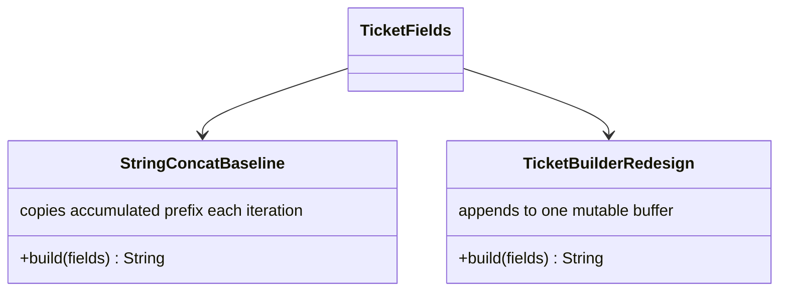

# Q7: Diagnose, redesign, validate

## D. Prediction (written before implementing the redesign)

Q1 measured a 5,000-field ticket at 11.284 ms with repeated `String` concatenation and 0.100 ms with `StringBuilder`, a roughly 113x difference; the source-level estimate was 5,000 intermediate strings versus one final ticket string. I predict that replacing repeated immutable-prefix reconstruction with one thread-confined builder will reduce mean construction time by at least 90%, reduce estimated intermediate result strings by at least 99%, preserve the exact ticket output, and retain approximately the same final output memory after GC. The builder requires a mutable backing buffer that grows with output size; this memory is a deliberate trade-off for avoiding repeated copies.

## A. Diagnose

Q1 identified the bottleneck: immutable `String` concatenation reconstructs the accumulated prefix on every field. The fresh paired run measured 5,000 field operations per strategy. The original averaged 13.184 ms (11.433-15.346 ms), versus 0.181 ms (0.065-0.384 ms) for the builder. The source-level estimate is 5,000 concatenation-result strings versus one final ticket string. Prefix copying accounts for quadratic character work; the growing final ticket is linear in output size. After-GC retained deltas were 45,869 and 45,808 bytes, respectively; this captures the retained result approximately, not transient allocation volume. The `String` immutability characteristic, not the ticket field model, creates the repeated copying.

## B. Design objective

Target: reduce estimated intermediate result strings from 5,000 to one and reduce mean construction time by at least 90% on the identical 5,000-field workload, while preserving the exact output.

## C. Revised solution

Replace loop-level `text = text + field + delimiter` with a per-ticket `StringBuilder`, append each field and delimiter, and materialize the result once. This changes cumulative character copying from quadratic prefix reconstruction to linear append work. The builder owns an expandable character buffer and final `String`; it is not shared across booking threads. The shared booking log remains a separately synchronized concern.

## E. Implement and validate

The paired implementation in `Main.java` used the same prebuilt field array, warmed each strategy, and recorded 10 timed runs per strategy with `System.nanoTime()`. It verified exact `String.equals` output before benchmarking. `results.csv` records the raw sample times, operation counts, object estimates, retained-memory deltas, and output checksum.

| Strategy | Mean | Min-max | Field operations/sample | Estimated intermediate result strings | Avg retained-memory delta |
|---|---:|---:|---:|---:|---:|
| Repeated `String` concatenation | 13.184 ms | 11.433-15.346 ms | 5,000 | 5,000 | 45,869 bytes |
| `StringBuilder` | 0.181 ms | 0.065-0.384 ms | 5,000 | 1 | 45,808 bytes |

Exact output equality passed; length/checksum was 45,765. Memory is the approximate live delta after GC with the returned value retained and should not be read as total bytes allocated during the run.

## F. Defend

The prediction was supported: mean time fell 98.63% (72.98x faster in this run), and the estimated intermediate result-string count fell 99.98%. The output remained exactly equal, while retained memory was effectively unchanged within the noise of approximate heap measurements. The redesign pays for a mutable backing buffer and final materialization, but avoids repeatedly copying the prefix. The original remains acceptable for tiny fixed expressions where readability matters more than allocation/copy cost; it is not appropriate for a large accumulation loop. A shared concurrent log still needs synchronization and should not reuse the per-ticket builder across threads.