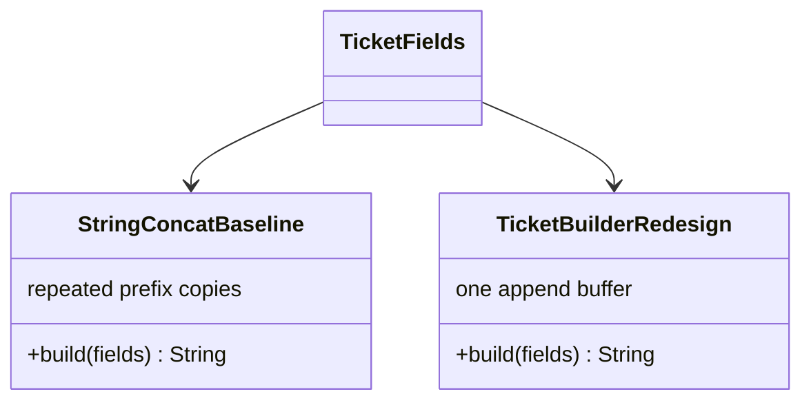

# Assignment 2 Report

**Programming in Java (CO2): Strings, Collections, `hashCode`/`equals`, Generics, Comparable/Comparator, Queues**  
**Student:** Yashaswini  
**Register No:** 192425250  
**Runtime:** Java 27; source uses Java 17-compatible language/library features.

All benchmark programs warm up before ten measured repetitions, time with `System.nanoTime()`, and save raw samples and operation counts in each question's `results.csv`. Times are local JVM observations, not portable guarantees. Heap deltas use `Runtime.totalMemory() - freeMemory()` around explicit GC and are approximate retained-memory readings, not allocation-profiler totals. The workspace began empty, so no supplied starter programs were available; equivalent compilable implementations were created.

## Q1: String Construction

**Prediction and design.** `String` is immutable. Loop concatenation rebuilds the accumulated prefix each time, so cumulative copied characters grow like $1+2+...+n=O(n^2)$. `StringBuilder` and `StringBuffer` append into expandable mutable storage with $O(n)$ character work and $O(n)$ output space. The program measures one eight-field ticket, 10,000 tickets x 50 fields, and one custom 5,000-field ticket.

| Workload | Strategy | Average | Min-max | Estimated intermediate result strings |
|---|---|---:|---:|---:|
| 8 fields | String | 0.052 ms | 0.026-0.111 ms | 8 |
| 8 fields | StringBuilder | 0.025 ms | 0.005-0.042 ms | 1 |
| 8 fields | StringBuffer | 0.022 ms | 0.006-0.034 ms | 1 |
| 10,000 x 50 | String | 18.414 ms | 15.488-32.539 ms | 500,000 |
| 10,000 x 50 | StringBuilder | 7.393 ms | 6.582-9.919 ms | 10,000 |
| 10,000 x 50 | StringBuffer | 9.785 ms | 6.968-19.176 ms | 10,000 |
| 5,000 fields | String | 11.284 ms | 10.214-13.444 ms | 5,000 |
| 5,000 fields | StringBuilder | 0.100 ms | 0.080-0.188 ms | 1 |
| 5,000 fields | StringBuffer | 0.086 ms | 0.081-0.094 ms | 1 |

The small-ticket prediction of a modest difference and large-ticket prediction of a substantial builder advantage were supported. On the custom ticket the builder was about 113x faster in the Q1 run. After-GC retained deltas were 112 bytes (short), 424 bytes (last retained ticket in bulk), and 45,832 bytes (custom ticket), with identical estimates for the three approaches because the final retained output dominates. At eight fields, `String.join`, `StringJoiner`, and `String.format` averaged 0.011, 0.015, and 0.018 ms. Joining is linear and concise; formatting is for formatted presentation, not repeated accumulation.

The shared-log demonstration used eight threads x 20,000 appends: `StringBuilder` produced 44,635 of 160,000 characters in that run, while `StringBuffer` produced all 160,000. Use a thread-confined builder per ticket and synchronization or an appropriate concurrent logging design for shared state.

## Q2: Playlist Collections

**Prediction and design.** `ArrayList` offers amortized $O(1)$ append, $O(1)$ indexed access, and $O(n)$ iteration; front/middle changes shift references in $O(n)$. `LinkedList` offers $O(1)$ end operations, but locating an index is $O(n)$ and each element needs a linked node. `ArrayDeque` supports efficient two-ended operations and iteration but no indexed access or direct middle insertion. The manual primitive array shows the shifting baseline without boxed references.

All three sizes (10,000 / 100,000 / 1,000,000) are benchmarked with ten repetitions. Setup is outside timed regions. This table shows per-operation averages derived from the recorded batched operation timings:

| Size | Operation | ArrayList | LinkedList | ArrayDeque | Manual array |
|---:|---|---:|---:|---:|---:|
| 10,000 | front insert/remove pair | 3.78 us | 0.40 us | 0.27 us | 8.61 us |
| 100,000 | front insert/remove pair | 13.38 us | 0.17 us | 0.39 us | 78.80 us |
| 1,000,000 | front insert/remove pair | 435.62 us | 0.38 us | 0.17 us | 178.56 us |
| 10,000 | middle insert/remove pair | 1.08 us | 18.10 us | unsupported | 5.16 us |
| 100,000 | middle insert/remove pair | 6.25 us | 133.37 us | unsupported | 39.33 us |
| 1,000,000 | middle insert/remove pair | 130.35 us | 3,036.17 us | unsupported | 82.80 us |
| 10,000 | k-th access | 51.5 ns | 3.38 us | unsupported | 21.4 ns |
| 100,000 | k-th access | 31.0 ns | 33.32 us | unsupported | 13.4 ns |
| 1,000,000 | k-th access | 64.4 ns | 104.95 us | unsupported | 31.3 ns |

Observed results match the shape of the complexity predictions: indexed access strongly favors contiguous storage, and a linked list does not make arbitrary middle access cheap. For a million-item playlist with 1,000 front edits/sec, the measured `ArrayList` mean projects to about 0.44 seconds of CPU per second on those edits. This is a practical stopping boundary for a queue-like workload, not a universal item-count threshold. When Up Next adds at both ends and removes at the front, prefer `ArrayDeque`; retain `ArrayList` when reads/indexing dominate. The full-add, iteration, and raw min/average/max measurements are in `Q2/results.csv`.

Storage summary: array-backed collections use a reference slot (plus spare capacity), the manual variant uses a primitive slot, and each `LinkedList` element requires a node with item and links plus object overhead. `ArrayDeque` is circular-array backed.

## Q3: Attendance Equality Contract

**Prediction and design.** Test 1 adds the same reference repeatedly and predicts size 1. Test 2 adds separate objects with duplicate registration numbers and predicts duplicates when `equals` has no matching `hashCode`. Test 3 mutates `regNo` after hash insertion and predicts failed lookup; a `TreeSet` whose natural comparison is by name is intentionally inconsistent with equality by `regNo`.

Before adding `hashCode`, `Q3/output-before.txt` recorded:

```text
Unique students: 3
```

After adding `hashCode()` as `Objects.hash(regNo)`, `Q3/output.txt` recorded:

```text
Unique students: 2
```

`HashSet` first uses `hashCode()` to select a bucket, then uses `equals()` among candidates in that bucket. Equal objects must hash equally; otherwise the duplicate scans may not be compared. The experiment confirmed same-reference set size 1, fixed duplicate set size 2, `contains` false after mutation, and a name-ordered `TreeSet` retaining two objects that are equal by registration number. A `TreeSet` comparator on registration number keeps one. A `HashMap<String, Student>` is another direct key-based alternative.

At one million students, 100,000 lookups averaged 0.885 ms for `HashSet`, 7.351 ms for `TreeSet`, and 0.902 ms for `HashMap`; one-million insert means were 28.333, 167.581, and 19.409 ms. Hash collections provide expected $O(1)$ operations; `TreeSet` provides $O(log n)$ and maintains order. Do not mutate fields used by `equals`/`hashCode` while the object is stored in a hash collection.

## Q4: Pharmacy Inventory Maps

**Prediction and design.** `HashMap`: expected $O(1)$ put/get and $O(n)$ unordered iteration. `TreeMap`: $O(log n)$ put/get and naturally ascending code reports. `LinkedHashMap`: expected $O(1)$ put/get and naturally insertion-ordered reports. A report using the wrong order needs key sorting ($O(n log n)$) or a separately tracked insertion sequence and map lookups ($O(n)$ extra references/work).

The lookup target was defined as less than 1 ms per lookup and less than 100 ms per 100,000-lookup batch. At one million medicines, the 100,000 lookup means were 0.786 ms (`HashMap`), 9.579 ms (`TreeMap`), and 1.066 ms (`LinkedHashMap`). The sorted-array `Arrays.binarySearch` alternative averaged 3.852 ms. All batch measurements satisfy the defined 100 ms limit.

| One million entries | HashMap | TreeMap | LinkedHashMap | Sorted array |
|---|---:|---:|---:|---:|
| Put/build average | 33.773 ms | 262.608 ms | 77.331 ms | 0.682 ms sort/build |
| 100,000 lookups | 0.786 ms | 9.579 ms | 1.066 ms | 3.852 ms |
| Code-order report | 40.107 ms | 133.742 ms | 46.470 ms | 0.283 ms |
| Insertion-order report | 23.350 ms with tracked sequence | 120.632 ms with tracked sequence | 14.487 ms | 39.579 ms using binary searches |
| Required-order check | passed | passed | passed | passed |

Choose `LinkedHashMap<Integer, Medicine>` for this pharmacy workload: insertion-order reporting is native, and its 100,000-lookups batch is well inside target. Create code-order reports by sorting a temporary key list; that cost was 46.470 ms at one million entries. Switch to `TreeMap` if code-sorted reports dominate and the insertion sequence can be maintained separately. A sorted array offers compact primitive storage and very fast code-order scanning, but live insertion/removal requires $O(n)$ shifting; it is best for static/rarely changed inventories. `Hashtable` is legacy and synchronizes individual methods, disallows null keys/values, and does not make multi-step report operations atomic. Prefer `ConcurrentHashMap` for modern concurrent key-value access when needed. Hashing, tree traversal, cache behavior, allocation, and GC affect observed timings.

## Q5: Generic Leaderboard

**Prediction and design.** `Leaderboard<T>` accepts `Comparator<? super T>` and `List<? extends T>`, copies input in its constructor, and returns a newly sorted copy. The comparator orders points descending, goal difference descending, and name ascending. The expected output is exactly:

```text
[Eagles(9,6), Bisons(9,4), Panthers(9,4), Cobras(6,1)]
```

Bisons ranks above Panthers because their points and goal difference tie, and `Bisons` sorts before `Panthers`. `Team.equals` uses the same fields as its ranking key; `Team.compareTo` demonstrates the natural-order alternative. The input remained unchanged. Tie tests verified all levels.

The key tuple $(-points,-goalDiff,name)$ with lexicographic component ordering is a total order. Sign symmetry gives antisymmetry; the first differing component establishes transitivity; comparison returns zero exactly when all ranking fields match. Avoid subtraction for comparator ordering: for `Integer.MAX_VALUE` and `-1`, `b.points - a.points` returned the same negative value in both directions. The 50,000-item deterministic stress test reproduced `Comparison method violates its general contract!` from TimSort.

At 100,000 teams, average times were 48.217 ms for one comparator-chain sort, 40.879 ms for `Comparable`, and 44.969 ms for three stable sorts. The chain and natural order use one $O(n log n)$ sort and $O(n)$ copy/workspace; stable name, goal-difference, and points sorts use three stable $O(n log n)$ passes and temporary sort space. Data distribution and TimSort's run detection affect constants. Use `Comparable` when a type has one universal order; use comparators for reusable policies across teams, players, and colleges. Stable multi-pass sorting is correct only when each pass is stable and runs least-significant key first.

## Q6: Triage Priority Queue

**Prediction and design.** A plain FIFO `Queue` cannot select by severity. `PriorityQueue` is ordered by ascending severity, then arrival counter, so equal severity remains FIFO. Only the heap head is guaranteed to be minimal; printing/iterating the heap does not show treatment order. Add and poll each have $O(log n)$ cost and heap storage is $O(n)$.

The exact expected program output was verified:

```text
Meena(S1) Kumar(S1) Lata(S2) Ravi(S3) John(S3) Asha(S5)
```

The hand-worked eight-patient order also matched: `Dev(S1), Hari(S1), Bala(S2), Farah(S2), Chitra(S3), Esha(S3), Asha(S5), Gopal(S5)`. Arrival sequence preserves FIFO within each severity.

| Patients | Add average | Poll-all average | Add throughput | Poll throughput |
|---:|---:|---:|---:|---:|
| 10,000 | 0.770 ms | 2.235 ms | 12.99M/s | 4.47M/s |
| 100,000 | 4.214 ms | 25.493 ms | 23.73M/s | 3.92M/s |
| 1,000,000 | 24.520 ms | 452.999 ms | 40.78M/s | 2.21M/s |

Starvation can occur if severe patients continually preempt a severity-5 patient. The demonstration reduces effective severity by one per 10 time units, floored at 1. A static heap comparator cannot observe changed priority while entries remain in place; a scheduled promotion pass must drain, update, and reinsert all waiting patients. This pass costs $O(n log n)$ overall due to reinsertion (or can heapify a rebuilt collection).

At 5,000 patients/day, average arrival rate is 0.058/s; measured throughput is far beyond that rate, so the data structure has ample average-volume capacity. This is not a full service-level proof for bursts, persistence, I/O, concurrency, or aging schedule. At 5,000 patients, the full-cycle benchmark measured 0.745 ms for PriorityQueue, 26.085 ms for sorted linked list, and 0.103 ms for five FIFO severity queues. A sorted linked list has $O(n)$ admission and $O(1)$ service; five fixed-severity queues have $O(1)$ admission/service and $O(n+5)$ storage, but need re-bucketing for aging.

## Q7: Diagnose, Redesign, Validate

**A. Diagnose.** The Q1 5,000-field ticket exposes the clearest bottleneck. `String` immutability makes each append rebuild the prefix; Q7's original averaged 13.184 ms (11.433-15.346 ms) for 5,000 field operations and estimated 5,000 intermediate result strings. The repeated copies account for $O(n^2)$ character work. The retained output dominated after-GC memory; transient allocation totals are not represented by that reading.

**B. Design objective.** Reduce mean construction time by at least 90%, estimated intermediate result strings from 5,000 to one, and preserve the exact ticket output on identical prebuilt fields.

**C. Revised solution.** Use a thread-confined `StringBuilder` per ticket, append each field and delimiter, and materialize the result once. This exploits mutable buffer append, avoids recreating/copying the prefix, and uses $O(n)$ time plus $O(n)$ buffer/output storage. The new buffer capacity is extra live memory; it is not shared across threads. Shared log synchronization remains separate.



**D. Prediction.** Before implementation, the prediction was at least 90% lower mean time, at least 99% fewer estimated intermediate strings, equal output, and approximately equal retained output memory after GC.

**E. Implement and validate.** Both methods used the same 5,000 prebuilt fields, ten timed runs after warm-up, `System.nanoTime()`, and an exact `String.equals` check. The raw rows are in `Q7/results.csv`.

| Strategy | Mean | Min-max | Field operations/sample | Estimated intermediate strings | Avg retained delta after GC |
|---|---:|---:|---:|---:|---:|
| Repeated `String` | 13.184 ms | 11.433-15.346 ms | 5,000 | 5,000 | 45,869 bytes |
| `StringBuilder` | 0.181 ms | 0.065-0.384 ms | 5,000 | 1 | 45,808 bytes |

Exact output equality passed; length/checksum was 45,765. Memory is an approximate live delta with the output retained, not total transient allocation.

**F. Defend.** The prediction was supported: mean time fell 98.63% (72.98x speedup), estimated intermediate strings fell 99.98%, and output stayed exactly equal. Retained memory differed by only 61 bytes, within the noise of this approximate measurement. The redesign pays for a mutable buffer and final string materialization. The original expression remains preferable for tiny fixed concatenations where clarity dominates; for large loops the builder is the better design.

## Completion and Run Steps

- Q1-Q7 each contain source, captured `output.txt`, raw `results.csv` where applicable, and prediction-first `notes.md`.
- Q3 preserves both baseline and corrected Attendance output.
- Q7 validates original and redesigned implementations under identical conditions.
- One Git commit was created per question, in Q1-to-Q7 order.

From the project root, compile and run each question in its folder. Examples: `Set-Location Q1; javac Main.java; java Main`; `Set-Location Q3; javac Student.java Attendance.java Experiments.java; java Attendance; java Experiments`; `Set-Location Q6; javac Patient.java Triage.java Main.java; java Triage; java Main`. Full PowerShell commands for every folder are in `README.md`.